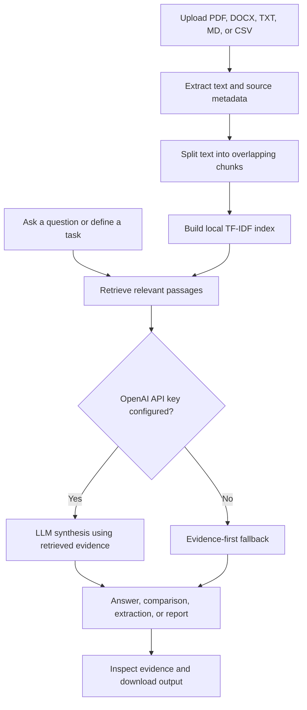

<div align="center">

# 📚 Document Reader RAG

### Turn business documents into answers, comparisons, structured data, and decision-ready reports.

**A business-focused document intelligence application built with Python, Streamlit, retrieval-augmented generation (RAG), and optional OpenAI-powered synthesis.**

<p>
  <a href="https://github.com/gabrielvanlalbera/Document_Reader-RAG-"></a>
  
  
  
  
</p>

**[Features](#-what-you-can-do) · [How it works](#-how-it-works) · [Installation](#-get-started) · [Project structure](#-project-structure) · [Roadmap](#-roadmap)**

</div>

---

## 💡 The problem

Business information is often scattered across long PDFs, policies, reports, contracts, and spreadsheets. Finding one important clause or comparing facts across multiple files can take far longer than it should.

**Document Reader RAG** gives you one workspace to upload documents, retrieve relevant passages, and work with the evidence they contain. Instead of relying only on a model's general knowledge, the RAG workflow supplies retrieved document text to the answer-generation step.

## ✨ What you can do

<table>
  <tr>
    <td width="50%" valign="top">
      <h3>💬 Document Q&A</h3>
      Ask questions in natural language and inspect the retrieved passages supporting the answer. Source filenames and page/row locations are retained where available.
    </td>
    <td width="50%" valign="top">
      <h3>🔎 Cross-document comparison</h3>
      Search across uploaded files for similarities, differences, and missing evidence around a comparison brief.
    </td>
  </tr>
  <tr>
    <td width="50%" valign="top">
      <h3>🧾 Structured extraction</h3>
      Request fields such as company name, contract dates, fees, renewal terms, or notice periods. Export the result as JSON for further processing.
    </td>
    <td width="50%" valign="top">
      <h3>📊 Evidence-backed reports</h3>
      Build a report around a business question and download the result as Markdown, together with the evidence used by the workflow.
    </td>
  </tr>
</table>

### 📂 Supported file types

- **PDF** (`.pdf`)
- **Microsoft Word** (`.docx`)
- **Plain text / Markdown** (`.txt`, `.md`)
- **CSV** (`.csv`)

> **PDF note:** Text-based PDFs are supported. Scanned or image-only PDFs need OCR preprocessing; OCR is not included in this version.

## 🧭 How it works



### The current retrieval approach

This version uses **TF-IDF keyword retrieval** as a lightweight, local baseline. It does not require a paid embedding API or a vector database. If `OPENAI_API_KEY` is configured, selected retrieved passages can be sent to the configured OpenAI model for grounded synthesis. Without the key, the app uses evidence-first fallback logic; that mode is more limited and may return extracted text rather than a polished summary.

## 🚀 Get started

### 1. Clone the repository

```bash
git clone https://github.com/gabrielvanlalbera/Document_Reader-RAG-.git
cd Document_Reader-RAG-
```

### 2. Create and activate a virtual environment

**Windows PowerShell**

```powershell
python -m venv .venv
.\.venv\Scripts\Activate.ps1
```

**macOS / Linux**

```bash
python3 -m venv .venv
source .venv/bin/activate
```

### 3. Install dependencies

```bash
python -m pip install --upgrade pip
python -m pip install -r requirements.txt
```

### 4. Configure environment variables

Create a local `.env` file from the example:

**Windows PowerShell**

```powershell
Copy-Item .env.example .env
```

**macOS / Linux**

```bash
cp .env.example .env
```

Open `.env` and optionally add your OpenAI API key:

```dotenv
OPENAI_API_KEY=
OPENAI_MODEL=gpt-4.1-mini
MAX_UPLOAD_MB=20
CHUNK_SIZE=1000
CHUNK_OVERLAP=150
TOP_K=5
```

The app can start without an API key. For LLM-powered generation, add your own key. API calls may incur charges. **Never commit `.env` or publish API keys.**

### 5. Launch the app

```bash
python -m streamlit run app.py
```

Open the local URL printed in your terminal, usually `http://localhost:8501`.

### 6. Try the included demo documents

In the **Ingest documents** tab, upload the sample files from `sample_data/`:

- `acme_company_overview.txt`
- `acme_refund_policy.txt`
- `acme_q1_summary.txt`

These documents describe a **fictional** company and contain synthetic values for testing. They are safe starter examples—not real business records.

## 🧪 Example questions to try

| Goal | Example prompt |
|---|---|
| Learn about a company | “What does the company do, and what are its stated priorities?” |
| Find a policy | “What is the return window and how long do refunds take?” |
| Compare documents | “Compare renewal terms, fees, and termination rights across these agreements.” |
| Extract fields | `Company name`, `Effective date`, `Annual fee`, `Auto-renewal` |
| Prepare a report | “Summarize Q1 performance, risks, and unanswered questions.” |

For best results, ask questions that match the information actually present in the uploaded documents. Always inspect the retrieved evidence for important answers.

## 🧰 Tech stack

| Component | Technology | Role |
|---|---|---|
| Interface | Streamlit | Interactive multi-workflow UI |
| Language | Python | Application logic and document workflows |
| Parsing | pypdf, python-docx, pandas | Extract text and tabular records |
| Chunking | Custom Python utilities | Split text while retaining source metadata |
| Retrieval | scikit-learn TF-IDF | Rank passages relevant to a query |
| Optional generation | OpenAI API | Synthesize answers from retrieved evidence |
| Testing | pytest | Unit tests for chunking and retrieval |

## 🗂️ Project structure

```text
Document_Reader-RAG-/
├── app.py                       # Streamlit application
├── requirements.txt             # Python dependencies
├── .env.example                 # Environment variable template
├── .gitignore                   # Excludes local secrets and environments
├── LICENSE
├── README.md
├── src/
│   ├── config.py                # App settings
│   ├── ingestion.py             # PDF, DOCX, TXT, MD, and CSV parsing
│   ├── chunking.py              # Text chunking and metadata
│   ├── retrieval.py             # TF-IDF search
│   ├── llm.py                   # Optional grounded generation
│   ├── workflows.py             # Q&A, comparison, extraction, reporting
│   └── evaluation.py            # Retrieval metric helpers
├── tests/
│   ├── test_chunking.py
│   └── test_retrieval.py
├── scripts/
│   └── evaluate_retrieval.py
└── sample_data/                 # Synthetic demo documents
```

## ✅ Test and evaluate

Run the unit tests:

```bash
python -m pytest -q
```

Run the sample retrieval smoke test:

```bash
python scripts/evaluate_retrieval.py
```

The retrieval script checks a few known queries against the synthetic sample documents. It is a **smoke test, not a comprehensive benchmark**. For a serious evaluation, create a test set from your target domain with questions, expected source passages, and criteria for answer faithfulness.

## 🌱 Roadmap

- [ ] Add dense semantic embeddings and compare retrieval quality against TF-IDF.
- [ ] Add hybrid keyword + semantic search and optional reranking.
- [ ] Improve answer-quality evaluation with retrieval recall, citation accuracy, and faithfulness metrics.
- [ ] Add document previews and clearer extraction diagnostics.
- [ ] Add persistent workspaces, authentication, and role-based access controls before multi-user deployment.
- [ ] Add OCR support for scanned documents.

## 🔐 Privacy, security, and limitations

- This is a **portfolio MVP**, not a certified enterprise document-management system.
- Uploaded files are processed by the running app. This version does not implement user accounts, access control, encrypted persistent storage, or audit logs.
- When OpenAI generation is enabled, retrieved document passages are sent to the OpenAI API. Do not process confidential, regulated, or personal data unless you have the required approvals and controls.
- Document text is untrusted input. Prompt instructions help reduce instruction-following from retrieved text but cannot eliminate prompt-injection risk.
- Retrieval can miss relevant passages, and generated answers can still be wrong or incomplete. Verify important claims against the original document.
- Before production deployment, add authentication, authorization, file scanning, rate limits, retention controls, monitoring, and domain-specific evaluation.

## ☁️ Deployment

The app can be deployed on a host that supports Python and Streamlit. For Streamlit Community Cloud, connect the GitHub repository, select `app.py` as the main file, and configure any required secrets in the deployment settings. Do not put secrets in source control.

> GitHub Pages alone cannot run this Python/Streamlit backend; it hosts static websites. Use a Streamlit-capable hosting service for an interactive deployment.

## 🤝 Contributing

Ideas, bug reports, and pull requests are welcome. If you suggest a feature, include the use case it addresses and how it can be tested. Keep secrets and private source documents out of commits.

## 📄 License

Distributed under the MIT License. See [`LICENSE`](LICENSE) for details.

---

<div align="center">

**Built to make business documents easier to search, compare, and turn into evidence-backed decisions.**

⭐ If this project is useful to you, consider giving the repository a star.

</div>
